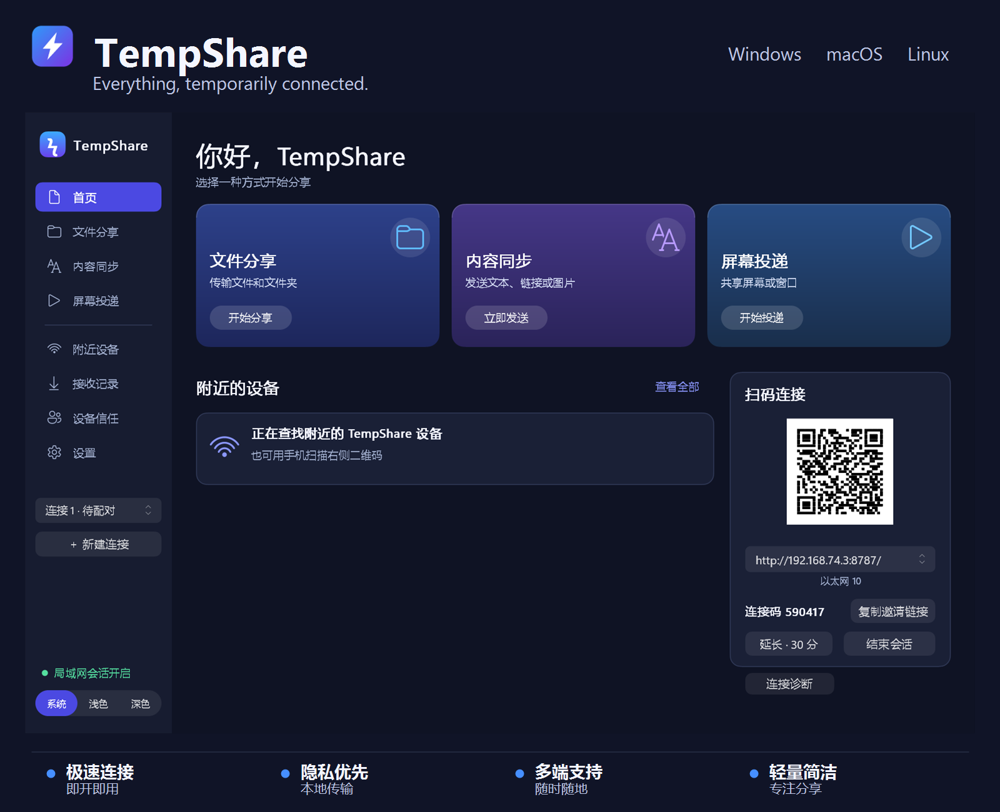

# TempShare

> Everything, temporarily connected.

TempShare 让同一私有局域网内的电脑、手机和平板临时连接，分享文件、同步内容和投递屏幕。电脑运行 Aino C++ 桌面客户端，手机扫描二维码或在浏览器中输入连接码即可加入。设备发现、配对和传输均在局域网内完成。不同私有网段之间只有在路由器允许互访时才可连接。



## 功能

| 功能 | 使用方式 |
| --- | --- |
| Share 文件分享 | 桌面可选择多个文件、将文件夹打包为 ZIP。Windows 支持把文件拖进窗口。桌面可以逐项确认上传，也可以一次确认当前页列出的文件。上传支持暂停、继续、取消和失败重试。下载由浏览器管理。 |
| Sync 内容同步 | 配对后双向发送文本、链接、代码和图片。桌面可主动发送剪贴板文本，双方都可以复制收到的文本。文本历史保留在当前会话中。 |
| Cast 屏幕投递 | 从桌面端打开投递控制台，再在浏览器的系统选择器中选择屏幕或窗口。已配对的网页可以通过 WebRTC 观看。支持调节画质和帧率，音频取决于浏览器和共享来源。 |
| 临时连接 | 附近设备发现、二维码、六位连接码和桌面验证码核对。一个会话连接一台浏览器，有效期为 30 分钟，双方都可以结束连接。 |
| 设备信任 | HTTPS 下可保存、更新和撤销设备信任。已记住的浏览器可按保存的权限快速连接，上传仍需确认。 |

单个文件和文件夹归档的上限均为 1 GiB。每次会话最多接收 4 GiB，同时处理最多 4 个传输。接收文件保存到会话子目录，重名时自动添加序号。

上传可在当前页面暂停后继续。HTTPS 下可预先勾选「允许本页刷新后重新选择文件续传」。刷新后在同一标签页选择原文件，校验通过后从服务器已保存的偏移继续。浏览器在该标签页保存校验值与请求编号，文件内容由用户重新提供。

## 构建

需要 CMake 3.20+、Git、C 和 C++17 编译器。首次配置拉取固定版本的 Aino、cpp-httplib、QR Code Generator 和 miniz。HTML、CSS 和 JavaScript 随可执行文件嵌入，运行时无需联网下载依赖。

### Windows

使用 Visual Studio 2022 或更新版本并安装 C++ 桌面开发组件。

```powershell
cmake -S . -B build -A x64
cmake --build build --config Release
ctest --test-dir build -C Release --output-on-failure
.\build\Release\tempshare.exe
```

Windows 也可以从资源管理器双击 `tempshare.exe`。启动错误会在窗口中提示。

### Linux / macOS

Linux 需要 X11 开发包，可安装 Zenity 使用文件选择对话框。macOS 使用 Xcode Command Line Tools。

```sh
cmake -S . -B build -DCMAKE_BUILD_TYPE=Release
cmake --build build --parallel
ctest --test-dir build --output-on-failure
./build/tempshare
```

当前已在 Windows 和 Linux 构建验证。macOS 是目标平台，尚待实机验证。

## 使用

1. 让电脑和手机连接到允许设备互访的家庭或办公私有网络，然后打开桌面客户端。
2. 手机扫描二维码，或打开桌面显示的局域网地址，再输入六位连接码。
3. 在桌面右侧连接栏核对浏览器显示的验证码，点击「允许连接」。连接栏在各功能页都可用。
4. 手机从「文件分享」接收或发送文件，或在「内容同步」发送文本。需要投递时，在桌面端选好共享来源，再在手机端点击「开始观看」。

桌面端默认使用 TCP 8787，端口被占用时选择可用端口。二维码和连接栏显示电脑当前可用的私有 IPv4 地址。不同私有子网之间需要路由器允许设备互访。连接手机时，应使用桌面当前显示的地址；关闭访客 Wi-Fi 隔离。Wi-Fi 断开或只有 169.254 自动地址时，应先恢复网络连接。多网卡设备可在桌面端切换地址。附近设备发现使用 UDP 47871 和 IPv4 组播。

首次运行的接收目录是启动目录下的 `received/`。在设置页选择新目录后，下次启动会沿用该目录。`--receive-dir <目录>` 可为本次运行指定接收位置。

## 局域网与 HTTPS

服务只绑定本机拥有的私有 IPv4 地址，并接受来自私有 IPv4 地址的连接。WebRTC 媒体流使用加密直连，信令由本机服务处理。默认的 HTTP 模式下，文件、文本和信令在局域网内以明文传输。需要加密这些请求或使用设备信任时，用 OpenSSL 3 和 `-DTEMPSHARE_TLS=ON` 构建，再指定证书和私钥。

```sh
./build/tempshare --cert cert.pem --key key.pem
```

证书需由参与设备信任，证书的 SAN 应包含桌面端展示的 IPv4 地址。使用 HTTPS 投递控制台时，SAN 还应包含 `127.0.0.1`，本机浏览器也需要信任证书。控制台在本机浏览器的屏幕捕获权限下运行。观看端使用支持 WebRTC 的浏览器。

[局域网 HTTPS 配置、故障定位和实机回归](docs/lan-https.md)

## 项目结构

| 路径 | 职责 |
| --- | --- |
| `src/client/` | C++ / aino 桌面 UI、系统文件选择与平台交互 |
| `src/core/` | 局域网发现、会话授权、设备信任、文件归档和 HTTP(S) 服务 |
| `src/web/` | 浏览器配对、文件传输、文本同步和 WebRTC 投递 |
| `tests/` | 授权、文件传输、文本同步、投递信令和网络变化集成测试 |

[产品定位和路线图](docs/产品定位.md) · [全项目工程审查](docs/codebase-audit.md) · [HTTP 接口](docs/http-api.md)

## 许可证

TempShare 使用 GNU Lesser General Public License v3.0（`LGPL-3.0-only`）。依赖沿用各自的上游许可证，Aino 为 Apache-2.0，cpp-httplib、QR Code Generator 和 miniz 为 MIT。[LICENSE](LICENSE)
