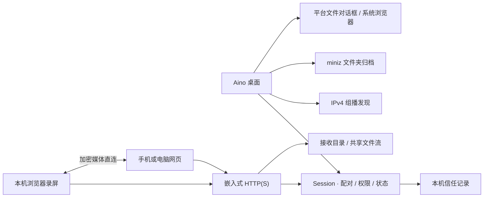

# TempShare 全项目工程审查

审查日期为 2026-11-24。基线为 `6e319b9`，审查对象包含本轮交互改动后的工作树。范围覆盖自有 C++、HTML、CSS、JavaScript、CMake、测试、许可证和文档，并追踪关键路径到固定版本依赖的接口。第三方源码完整审计、外部渗透测试和实机性能基准属于后续验收。

2026-11-25 已落实的修复、验证结果和剩余事项记录在 [整改记录](#11-整改记录)。

## 1. 整体架构

`tempshare_core` 隔离 Aino 和各平台窗口代码。共享、同步、投递统一使用同一临时会话。HTTP 请求以按块的方式落盘或下载，浏览器资源编译进程序，WebRTC 使用本机信令和 host ICE candidates。运行时的网络服务和发现范围限定在局域网。界面通过 `Window::wake()` 刷新，线程同步由核心层负责。

主要耦合集中在 `Session` 对凭证、上传状态、持久信任和信令的统一锁，以及 `HttpServer` 构造函数对所有路由、响应序列化和文件传输的集中管理。两端 UI 各用一个主文件同时处理生命周期、布局和任务状态。新增能力常需要同时修改四处，竞争条件和错误反馈容易出现不一致。依赖方向本身清楚，适合先收窄边界，再根据测试和测量决定是否拆锁。[构建目标](../CMakeLists.txt#L34) · [会话声明](../src/core/session.hpp#L92) · [HTTP 路由](../src/core/http_server.cpp#L165) · [桌面运行入口](../src/client/main.cpp#L541)

## 2. 模块审查

| 模块 | 源码行为与质量判断 | 建议 |
| --- | --- | --- |
| 桌面交互 | `render_connection` 将配对、待接收入口、停止共享放到各页共用的连接栏。`render_share` 按显示的请求 ID 审批，保留逐项操作。Win32 构建使用图形子系统，Aino 使用系统浅色主题。布局仍使用固定轨道，调整窗口和 DPI 时需实机检查。 | 保留当前页面模型，先抽离运行生命周期与页面布局。添加最小窗口、DPI、键盘和长文件名验收。[main.cpp](../src/client/main.cpp) |
| 平台层 | Windows 走 COM 对话框、窗口子类和 Shell API，macOS 走 Cocoa，Linux 使用 Zenity 和 `xdg-open`。Linux 的返回值只表示进程已启动，对话框输出通过 `|` 分割，文件名包含该字符会拆错。 | 给选择结果区分取消、工具缺失与失败。Linux 多选通过文件 URI 或可靠分隔传输，并测试 Unicode 路径。Windows 验证目录权限、长路径和高 DPI。[platform.cpp](../src/client/platform.cpp) |
| 会话与授权 | `Session` 校验短码、二维码、临时 Cookie、信任 Token、文件许可和投递角色。`begin_upload`、`finish_upload` 在同一锁内验证提交状态，避免取消后的文件进入接收记录。持久信任通过文件保存，重连恢复已保存权限。 | 先明确锁内可做的操作，减少持锁 I/O，以及在锁内调用外部回调。把配对与上传状态类型区分开。[session.cpp](../src/core/session.cpp) |
| HTTP 与文件传输 | cpp-httplib 路由统一执行 Host、子网、请求头与 body 限制。文件传输使用流式读写和临时文件重命名。部分端点将授权、状态冲突和磁盘错误压在相同 HTTP 状态里。 | 保持 V0 路径和旧请求可用。为常见错误新增机器可读的错误码，拆出传输和投递路由注册，再针对客户端统一映射错误。[http_server.cpp](../src/core/http_server.cpp) |
| 局域网发现 | `lan_networks` 枚举可用私有 IPv4，优先实体网卡。`announce` 广播设备信息、合并地址端口并移除过期设备。广告用于导航，实际授权走配对会话。 | 为组播失败增加可追踪状态。维护网卡变化和双实例接入测试。设备可信标识来自配对层，组播名称保持未验证提示。[discovery.cpp](../src/core/discovery.cpp) |
| ZIP | `archive_folder` 在工作线程逐条归档，支持取消和大小上限。会话与下载响应共同保留临时目录所有权。本轮修复了归档临时目录时可能递归包含自身的问题。 | 为跨平台解压加入 Unicode、大小写碰撞、空目录、临时空间不足和中断测试。记录归档创建和清理失败。[folder_archive.cpp](../src/core/folder_archive.cpp) |
| Web 会话与传输 | `app.js` 使用 DOM 安全输出、请求代际号和分块上传，操作反馈集中到页面上方。页面管理、排队、文本与媒体状态都在同一个模块。 | 优先将上传状态机与会话轮询拆成客户端模块，并为暂停、重试、断开和重新进入页面建立状态转移测试。[app.js](../src/web/app.js) |
| Cast | `cast-host.js` 由用户手势触发屏幕选择，`rtc.js` 负责 ICE 等待；服务只向已配对浏览器发布信令，并限制本机控制台端点。共享来源就绪反馈与实际媒体连接分开。 | 增加观看端租约或标签页选主。记录 ICE 失败、源关闭与权限拒绝的独立状态，验证浏览器后台挂起和页面恢复。[cast-host.js](../src/web/cast-host.js) · [rtc.js](../src/web/rtc.js) · [signal routes](../src/core/http_server.cpp#L309) |
| 构建与分发 | 四个直接依赖固定到提交，TLS 通过可选 OpenSSL 3 打开。CMake 生成 Web 内嵌头文件。仓库当前未包含跨平台 CI、安装目标、可重复发布产物或依赖通知打包流程。 | 建立 Windows、Linux 和 macOS 构建矩阵及启用 TLS 的变体，固定发布器版本，生成许可证通知和依赖清单，并为包内运行与离线启动加冒烟测试。[CMakeLists.txt](../CMakeLists.txt) · [LICENSE](../LICENSE) |
| 测试与文档 | CTest 的单个集成程序包含配对、权限、重名、空文件、上传断点、ZIP、信任和 WebRTC 信令。README 有构建、证书和操作说明，产品路线图说明局域网范围。服务协议、错误语义和系统故障排查较分散。 | 分离 CTest 场景与故障输出，增加 UI/时序/压力测试。用可运行的契约示例说明 Cookie、权限、上传偏移和错误处理。[integration.cpp](../tests/integration.cpp) · [README](../README.md) |

## 3. 问题与严重程度

**Critical。** 本轮检查未确认可跨越既有访问边界且无需额外条件的严重漏洞。下面的问题按代码证据和可预见的影响分级，安全边界仍需独立验收。

| 级别 | 类型 | 定位、原因与影响 | 改进及验收 |
| --- | --- | --- | --- |
| High H1 | 确定 | `HttpServer` 默认 HTTP。邀请、临时 Cookie、文件、文本及信令缺少链路认证与加密。WebRTC 媒体本身有加密，HTTP 信令完整性取决于局域网。设备信任已要求 HTTPS。 | 先提供可安装的局域网 CA 指南和准备检查，再评价原生端绑定证书、公网无关的应用层配对密钥方案。手机 Safari/Chrome 和原生端分别验收。[HTTP 构造](../src/core/http_server.cpp#L165) · [HTTPS 配置](../README.md#局域网与-https) |
| High H2 | 确定 | `HttpServer` 的 8 个工作线程共用短控制请求、文件流、握手和大上传。读写超时只约束单次等待。持续慢流量可能长期占用工作线程，导致审批、状态和投递停止反馈延迟。 | 配置每个会话和地址的传输并发及最低速率或滚动时间预算。保证控制请求保有容量，再考虑分离工作队列。用正常传输与低速连接并行测试控制请求 P95。[HTTP 配置](../src/core/http_server.cpp#L179) · [上传](../src/core/http_server.cpp#L398) |
| High H3 | 确定 | `Session::offer` 限制请求数量和单文件大小。`begin_upload` 没有会话总字节、已写临时字节及剩余磁盘预算。桌面批准的多文件总量可以超过可用空间，断线残留也会暂用空间。 | 审批前展示总大小，保留可配置空间余量，对当前会话预留配额。失败时返回明确的空间错误，并在下次启动清理可识别的旧临时文件。做低磁盘和中断测试。[Session::offer](../src/core/session.cpp#L424) · [Session::begin_upload](../src/core/session.cpp#L470) |
| High H4 | 风险 | `Session::share` 保存路径和大小。`send_file` 再按路径打开，主要比较大小。分享后被替换为同大小文件，下载可能得到用户最初未选中的内容。ZIP 的遍历检查与实际打开也存在时间间隔。 | 下载从已验证的打开句柄读取，并校验可用的文件身份、类型与修改版本。对需要固定内容的分享建立只读副本。用本地替换、移动、截断和跨平台链接测试。[Session::share](../src/core/session.cpp#L255) · [send_file](../src/core/http_server.cpp#L134) · [archive_folder](../src/core/folder_archive.cpp#L68) |
| Medium M1 | 确定 | `snapshot` 在锁内复制所有消息、文件和接收历史，每次 Aino 重绘都调用。50 条 32 KiB 文本约有 1.56 MiB 内容，接收记录随进程运行持续增长。 | 首先按页面取所需数据、给接收记录分页与上限。测量帧开销、分配量、锁等待及 P95；确认后再考虑不可变快照。[Session::snapshot](../src/core/session.cpp#L238) · [Aino 循环](../src/client/main.cpp#L575) |
| Medium M2 | 确定 | `poll` 每约 1.1 秒请求配对、文件与上传列表，连接正常时空闲也约 2.7 次请求每秒。HTTP keep-alive 上限当前为 1。投递时观看端额外轮询，组播发现每 200 ms 检查网卡快照。 | 使用按数据分类的版本号，隐藏页退避并在恢复时立即刷新。测每分钟请求数、首次可见延迟和后台投递稳定性。[poll](../src/web/app.js#L475) · [HTTP 配置](../src/core/http_server.cpp#L179) · [Discovery::announce](../src/core/discovery.cpp#L237) |
| Medium M3 | 确定 | `cast_viewer` 用一个 `viewing` 布尔值记住观看者。相同 Cookie 的多标签页或乱序的停止与心跳请求可能互相改变状态。新增就绪标记改善等待反馈，媒体状态仍缺少标签页隔离。 | 给每次观看短租约和代际号。仅同一租约可回答或停止。保留老接口过渡期，写双标签页与断线回归。[Session::cast_viewer](../src/core/session.cpp#L681) · [stopViewing](../src/web/app.js#L251) |
| Medium M4 | 确定 | `Session::notify` 由多条持锁路径调用，保存信任、清理临时文件和发布接收文件也可能在锁内接触磁盘。当前回调只唤醒 Aino，向可重入回调演进会产生死锁风险。 | 声明回调契约并将通知移到释放锁以后。磁盘写入使用准备、复核、提交三个阶段，保住撤销和完成的线性化点。[Session::notify](../src/core/session.cpp#L176) · [finish_upload](../src/core/session.cpp#L509) |
| Medium M5 | 确定 | Web 在页面对象里持有文件和上传 ID，刷新会清空队列；服务仍保留会话、请求和偏移。完成或拒绝的请求继续占用 100 项的会话上限。 | 先给终态使用有界历史与回收策略。需要支持刷新续传时显式要求重选同一文件，再校验大小和内容身份，避免自动续传错误文件。[submitFile](../src/web/app.js#L328) · [offer](../src/core/session.cpp#L424) |
| Medium M6 | 确定 | `download` 用 HTTP 状态 404 表示权限关闭或文件不存在。`upload` 的 409 混合审批、偏移冲突和目录错误。浏览器仅显示粗粒度重试，文件选择失败也可能与取消相同。 | 保持现有状态码兼容，增加 `error.code` 并为可恢复错误提供动作。加入权限变更和磁盘故障回归。[download / offer](../src/core/http_server.cpp#L344) · [上传](../src/core/http_server.cpp#L398) · [平台文件选择](../src/client/platform.cpp#L22) |
| Medium M7 | 风险 | `lan_sdp` 和 HTTP 拒绝公网来源，允许经路由的私有 IPv4 子网。访客网络隔离、VPN 路由、mDNS 或移动浏览器后台限制仍可能阻止配对或观看。 | 集成测试确认 SDP 拒绝公网候选。双网卡、隔离 Wi-Fi、Windows/macOS、iOS/Android 实机仍需验证。[lan_sdp](../src/core/http_server.cpp) |
| Medium M8 | 风险 | `random_token` 使用标准库 `std::random_device`。各目标库实现和错误行为不同，源代码没有声明使用何种系统随机源。明文持久信任记录依赖操作系统配置目录权限。 | 在平台矩阵上明确和测试系统 CSPRNG；确认 Windows ACL 和类 Unix 目录权限。重构返回值前加迁移及权限测试。[random_token](../src/core/session.cpp#L73) · [Session 构造与信任](../src/core/session.cpp#L135) |
| Medium M9 | 确定 | 项目缺少自动化 macOS、移动 Safari、Wayland、发布包和系统录屏权限测试。Linux 桌面构建在目前配置中依赖 X11。 | 先加 CI 编译与 CTest，再用可控的真实网络补运行矩阵。录屏源、音频与防火墙使用实机 checklist。[CMake 平台配置](../CMakeLists.txt#L53) |
| Low L1 | 确定 | 桌面 `page_controls` 和多数页面采用固定高度及页容量。较多文件仍要翻页，长名称需要更可靠的路径查看和截断提示，收到图片目前走文件流。 | 给文件队列加入可滚动列表和按批评审。用窄窗口、长文件名、200% DPI 和键盘检查操作可达性。[page_controls](../src/client/main.cpp#L137) · [render_share](../src/client/main.cpp#L257) |
| Low L2 | 风险 | Linux `Discovery::announce` 直接把描述符交给 `FD_SET`。进程持有大量描述符时可能超过 `FD_SETSIZE`。当前单进程正常使用的连接和文件数有限。 | POSIX 用 `poll` 或显式上界判断，保留 Windows `select` 路径并回归关闭行为。[Discovery::announce](../src/core/discovery.cpp#L278) |
| Low L3 | 确定 | `platform.cpp` 多分支将选取失败、外部工具缺失和取消都归为无结果。文件接收记录只存在于当前进程。 | 先为常用故障提供独立提示，再根据产品是否需要长久历史决定是否做本地索引。[choose_paths](../src/client/platform.cpp#L22) · [Snapshot](../src/core/session.hpp#L71) |

## 4. 性能瓶颈与验证

| 位置 | 优化原理、预期收益和代价 | 验证 |
| --- | --- | --- |
| Aino CPU 重绘 | 将 ZIP 和传输进度的唤醒合并，只有可见进度跨阈值才刷新。只拷贝可见快照，避免文本历史参与每帧渲染。减小空闲 CPU、分配和锁持有。节流会降低进度显示频率，目标可设为 4 至 8 Hz。 | Windows ETW 或 Linux `perf`，分别记录静置、100 项列表和 1 GiB 上传的 CPU 时间、帧 P95、卡顿时间。 |
| HTTP、TLS 和线程 | 探索短请求连接复用及按角色限流；批量传输保留分块边界。减少握手开销并保住控制面响应。连接复用占用更多长期 socket 资源，限流可能降低弱网吞吐。 | 1、3、8 并发下载或上传，对比吞吐、HTTPS 握手数、控制 API P95、活跃 socket 和恢复时间。 |
| 下载路径 | 流式回调按 64 KiB 进行文件定位、读和授权检查。对顺序读取只在偏移不连续时 seek，保留 Range 和权限撤销安全点。收益在本地快盘及高吞吐链路更可能可见。 | 比较顺序、单 Range、多 Range 和中途撤销。记录字节一致性、CPU、IO 调用和吞吐。[send_file](../src/core/http_server.cpp#L134) |
| ZIP IO | 当前流式压缩与边界检查控制了内存。对已压缩格式考虑存储模式，减少 CPU 与耗时，归档可能更大。路径安全检查仍需保留。 | 用大量小文件、图片视频和可压缩文本各测一轮，记录 RSS、耗时、输出字节和取消延迟。[archive_folder](../src/core/folder_archive.cpp#L68) |
| WebRTC CPU/GPU | 采集、编解码和渲染主要由浏览器处理，Aino 页面使用 CPU 绘图。根据 `getStats()` 中的丢包、编码负载和可用码率设置上限，必要时降低分辨率或帧率。硬编支持随平台变化，质量切换需要滞后防抖。 | 固定画面、快速滚动、720p/1080p 各测端到端延迟、丢帧、CPU/GPU 和音频同步。 |
| 空闲联网 | 状态版本和按可见性调度减少重复传输。对组播等待使用更长 timeout，并以可唤醒的网络变更事件触发重新订阅。系统事件订阅会增加平台适配成本。 | 测桌面和浏览器空闲一分钟的请求、定时唤醒与流量；确认恢复可见、网络切换和投屏就绪提示延迟。 |

以上为源码成本模型和可测量假设，未据此报告吞吐提升、延迟改善或 GPU 利用率数值。

## 5. 冗余与可清理内容

| 候选 | 判断依据 |
| --- | --- |
| 旧的移动端雷达装饰与 CSS | 本轮已删除对应 DOM 和选择器；它们占首屏、与配对状态数据无关。保留简洁应用标题和状态。 |
| 反复计算或序列化工作 | `Session::snapshot`、下载列表 JSON 和 `Discovery::peers` 返回全量副本。它们支撑现有调用，清理方式是缩小数据范围和避免刷新未变资源。 |
| 分散的剪贴板和状态处理 | 桌面复制链接、发送剪贴板、复制文本分别有失败逻辑；Web 有浏览器剪贴板回退。适合统一用户反馈和成功/失败分类，平台接入仍有必要。 |
| 会话字段与路由职责混合 | `State` 同时服务配对和上传。`GET /api/cast/host` 既返回信令又刷新存活计时。两者有实际调用，待引入各自类型或专门心跳时保留接口过渡。 |
| 依赖清理 | Aino、cpp-httplib、QR Code Generator、miniz 均有实际入口。OpenSSL、Zenity 和 `xdg-open` 对应可选能力或 Linux 系统交互。当前没有证据支持移除上述依赖。 |

## 6. 功能完整性

- 文件分享覆盖双向文件、桌面 ZIP、上传进度、重试及续传。100 项配额、接收盘空间不足提示、浏览器刷新后恢复和批次级摘要仍需完善。下载暂停及恢复由浏览器下载器负责。
- 内容同步支持纯文本、链接、代码、桌面主动读取剪贴板。图片目前通过文件授权和传输流发送。适合补收件侧图片预览及会话历史导出，优先限制像素、内存和可渲染类型。
- 投递支持本机浏览器捕获，配对端观看，源和帧率由浏览器控制。系统音频、Safari、多个观看标签页、后台唤起及失败回退需要完善或实机确认。
- 连接提供二维码、手动短码、附近设备与 HTTPS 可信重连。每会话一台设备，应用关闭后接收历史列表重置。多网卡情况下用户仍可能需要切换地址；可按网关、活动接口和手动偏好改善选择。
- 默认 HTTP 与产品的传输加密目标存在差距。HEIC 等图片类型的预览兼容性、跨平台拖放与系统通知也尚在验收范围内。[产品目标](产品定位.md) · [实际能力](../README.md#功能)

## 7. 推荐重构方案

1. **先固定契约。** 为现有 HTTP 路由、权限、错误码、上传偏移和投递修订建测试。允许新增字段，保持现有客户端与旧的单体上传调用可用。给易回归的时序加测试，再拆文件。
2. **提取功能路由。** 以 `HttpServer` 持有网络策略与连接生命周期，配对、传输、文本和投递各注册自己的路由。公共路径、错误对象、会话时效保持原约定。
3. **缩小状态层。** 将信任持久化抽到可注入的存储模块。将上传生命周期、信令租约及 UI 的轻量快照与当前会话身份区分。优先保持一把状态锁和明确的磁盘提交点，再由测量决定锁粒度。
4. **按用例拆客户端。** 桌面运行对象负责线程和系统集成，页面负责呈现。Web 把配对状态、传输队列、同步和观看拆成模块，控制面调度集中处理浏览器可见性、重试和请求取消。通过打包资源路由清单及浏览器回归保护兼容。

较大的协议、持久格式和传输调度改动建议先撰写兼容设计，验证失败回滚和已有会话后再上线。

## 8. 分阶段路线图

| 阶段 | 工作顺序 | 预期结果与退出条件 |
| --- | --- | --- |
| P0 近期 | 文件身份校验 → 接收配额和原子落盘故障测试 → 控制请求可用性 → HTTPS 与证书指南 | 同名替换不会悄悄传错文件，接收磁盘不足有明确反馈，持续传输时可及时断开。 |
| P1 近期 | 移动端和高 DPI 验收 → 明确错误码 → App 浏览器回归自动化 → 跨平台 CI | 批量、断点、权限和投递路径在 Windows/Linux 每次变更自动验证；macOS 和实体手机有可复现记录。 |
| P2 中期 | 状态版本 → 限制快照开销 → 路由拆分和信任迁移测试 → 投递租约 | 网络和空闲 CPU 成本可量化，服务职责和会话生命周期可独立测试。 |
| P3 长期 | 硬件来源和音频矩阵 → 健康诊断 → 离线发布与供应链能力 | 可从日志定位组播、证书、磁盘和媒体问题，安装包具有可复现构建信息、依赖通知与验收。 |

## 9. 产品发展与创新

| 方向 | 时期 / 优先级 / 难度 | 用户问题、实现与收益 |
| --- | --- | --- |
| 接收批次摘要和内容预览 | 短期 · P1 · 中 | 先汇总来源、数量与空间，再允许按批选择。图片先走既有授权，可用受限缩略图。减少重复授权和同名文件误收。参考 LocalSend 的局域网接收体验。[LocalSend](https://github.com/localsend/localsend) |
| 不联网的连接自检 | 短期 · P1 · 中 | 对组播、当前地址、HTTP(S) 和本机证书给检查结果。生成仅含用户选择字段的诊断摘要，提高隔离 Wi-Fi、多网卡和防火墙场景成功率。 [LocalSend 网络排查](https://github.com/localsend/localsend#troubleshooting) |
| 单一入口接收临时内容 | 中期 · P2 · 中 | 把手机入口的文件、文本和可观看状态汇总成已配对设备的活动流。继续复用各项授权和会话过期。可借鉴 PairDrop 的设备优先入口，服务和信令留在局域网。[PairDrop](https://github.com/schlagmichdoch/PairDrop) |
| 文件校验与可靠续传 | 中期 · P2 · 中高 | 对大文件补按块校验和重选校验，让传输在浏览器刷新和网络切换后恢复。仅保存会话所需的有界元数据。借鉴 Syncthing 的块校验思路，保持临时分享模式。[Syncthing Block Exchange Protocol](https://docs.syncthing.net/specs/bep-v1.html) |
| 局域网设备身份与加密向导 | 中期 · P1 · 高 | 经过本地确认引导安装证书或配置信任，给愿意配置的家庭和团队稳定的加密和身份验证。处理浏览器证书信任、IPv4 变更和更新回滚。[LocalSend Protocol](https://github.com/localsend/protocol) |
| 投递诊断和适应网络 | 中长期 · P2 · 中高 | 根据浏览器 stats 提供速率、丢帧和源不可用提示，并适度降低帧率，改善同一 Wi-Fi 下画面卡顿。保持浏览器本机授权和局域网媒体直连。[WebRTC Stats](https://www.w3.org/TR/webrtc-stats/) |

## 10. 本轮交互改动与验证

- 桌面各功能页共用连接栏。配对可以在当前页面完成，有待接收文件时可跳转到接收列表。批量审批只包含当前页展示的待批准 ID。
- 手机首屏先显示从电脑接收的文件。手动配对将设备名称放入可选项。取消待配对请求与断开已连接会话分别呈现。
- 投递就绪取决于本机实际选了共享来源。手机在来源就绪后可观看，桌面从任一功能页停止。未确认的连接请求在两分钟后撤销并更新邀请。
- 集成测试增加批量授权边界、取消配对、投递就绪授权和停止状态。Windows MSVC Release 与 Ubuntu GCC Release（启用 OpenSSL）均执行 CTest。
- 在 Xvfb 中运行 Aino，通过 Edge 从窗口截图解析真实二维码，在桌面处于内容同步页时批准配对。全程使用嵌入式服务，验证从跨页待接收入口一次批准两份文件，并在 320、390、1024 像素宽度检查页面水平溢出。桌面与移动页面使用 macOS 风格浅色层级。
- 使用生成的视频源替代系统录屏选择器，验证手机尺寸页面等待来源就绪、接收并播放 WebRTC 视频，从桌面连接栏停止后视频隐藏。该验证覆盖信令、媒体传输和 UI 状态。系统屏幕选择器、共享音频、macOS 以及实体手机尚未实机验收。
- 在 Linux 集成夹具中临时添加私有第二子网地址，确认另一私有地址可访问桌面健康接口。公网候选和未拥有的本地目标接口由相同策略测试拒绝。
- 本工作站的 Wi-Fi 适配器已报告 Disconnected，当前唯一用户网络为以太网 `192.168.74.3/24`。因此不能在此机验证手机能否通过用户家中路由器访问电脑；若路由器隔离设备，仍需先调整路由器或让手机加入能访问该地址的网络。

## 11. 整改记录

| 对应条目 | 已落实 | 剩余验证或边界 |
| --- | --- | --- |
| Windows 双击 | 链接为 Windows GUI 子系统，通过 `wWinMain` 读取 Unicode 参数，启动失败显示图形对话框。已实际启动图形窗口，CTest 检查可执行文件的子系统。 | 在其他 Windows 机器验证发布包及运行库。 |
| H1 传输安全 | 补齐局域网 CA、浏览器证书信任、SAN、HTTPS 启动与故障说明。Linux 支持 OpenSSL 构建，浏览器测试通过 HTTPS 配对和恢复上传。 | HTTP 兼容模式仍为默认。自动签发和分发可信证书涉及设备信任部署，仍需单独设计并在手机实机验收。 |
| H2 传输并发 | 最多同时处理 4 个文件流，为 8 个请求线程留出控制余量。上传有请求时限，下载有流期限。新版返回带 `Retry-After` 的 503。并发回归确认四路上传中仍可查询配对。 | 限制主要覆盖已匹配的文件路由。TLS 握手、请求头和全局工作队列仍共用线程，持续慢连接和高负载需在实际局域网验证。 |
| H3 接收存储 | 会话累计限制为 4 GiB。确认时计算已保留空间，上传时检查磁盘余量。旧分块在专用目录内超过 48 小时才回收。批量按钮旁显示已列出文件量。 | 回归覆盖配额释放和旧临时文件清理。磁盘在上传期间被其他进程写满时仍以 I/O 结果为准，大规模真实压力待验证。 |
| H4 文件身份 | 使用同一个 OS 文件句柄读取并校验文件 ID、大小与时间戳。ZIP 同样检查实际打开的文件。回归覆盖等长、同修改时间的替换。 | 文件系统的身份和变更时间精度依实现而异。跨文件系统的快照语义和锁定策略仍需验收。 |
| M1、M2 状态开销 | 桌面按页面读取快照，接收记录保留最近 200 项。网页只刷新版本有变化的列表，隐藏且无任务时暂停常规轮询。顺序下载跳过多余的 seek。 | 空闲 CPU、网络和控制请求 P95 仍需在真实设备测量。 |
| M3、M7 投递 | 观看租约使用独立标签页标识，第二个标签页无法停止或接管活跃租约。私有子网可经路由互访。兼容原有单观看者流程。 | 真实手机、访客隔离网络、多网卡、系统录屏和音频需要硬件验证。mDNS 候选依赖当地网络。 |
| M4 模块与锁 | 状态回调在释放锁后触发，回归允许回调再读快照。HTTP 路由按页面、配对、投递和传输拆分注册，共用网络策略。接收目录和剩余空间探测移出会话锁，探测后重新核对授权、写入进度和目录。 | 信任持久化和文件发布仍有受锁保护的 I/O。需测量锁持有时间，并保留原子提交边界。 |
| M5 续传 | 终态记录有界回收。HTTPS 可在同一标签页刷新后重选原文件并校验全部内容，再恢复偏移。Edge 已验证等长错误文件被拒绝以及正确文件字节落盘。 | 浏览器标签页关闭后会话存储随之销毁。跨会话任务恢复和跨设备历史属于独立产品能力。 |
| M6、L3 错误 | 对文件变化、工作线程繁忙、授权和偏移、接收目录与空间增加机器可读的错误码。Windows/Linux 文件选择器可区分系统失败和用户取消。 | Linux 存在 Zenity 多选分隔符兼容边界。持久接收历史仍需产品取舍和长期存储模型。 |
| M8 随机源 | 会话令牌、验证码和临时路径统一使用 Windows BCrypt、Linux getrandom 或 macOS 系统随机源。 | 信任记录的 Windows ACL 依赖用户应用数据目录，需要在受管桌面环境验收。 |
| M9、L1、L2 工程 | 添加 Windows、Linux、macOS 的 CI 矩阵与安装产物规则。分享和接收列表可滚动。POSIX 发现使用 poll。补充 HTTP 契约与实机验收文档。 | CI 的远程 macOS 结果、Wayland 后端、200% DPI、系统录屏和移动设备仍需相应环境。 |

[HTTPS 与实机验收](lan-https.md) · [HTTP 契约](http-api.md)
